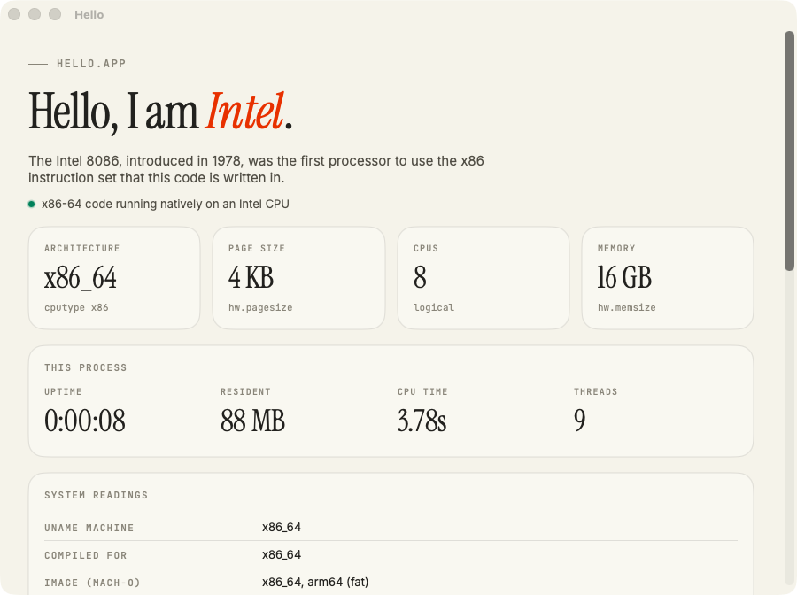
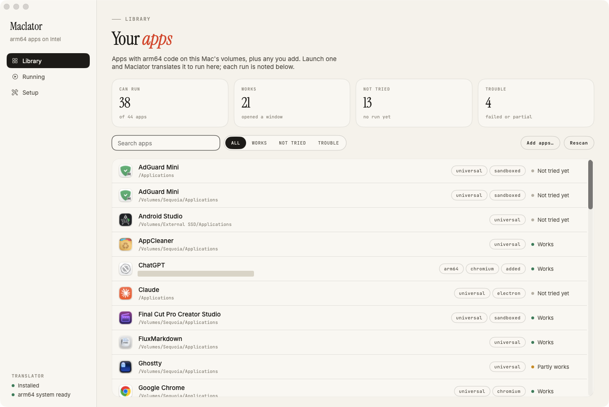
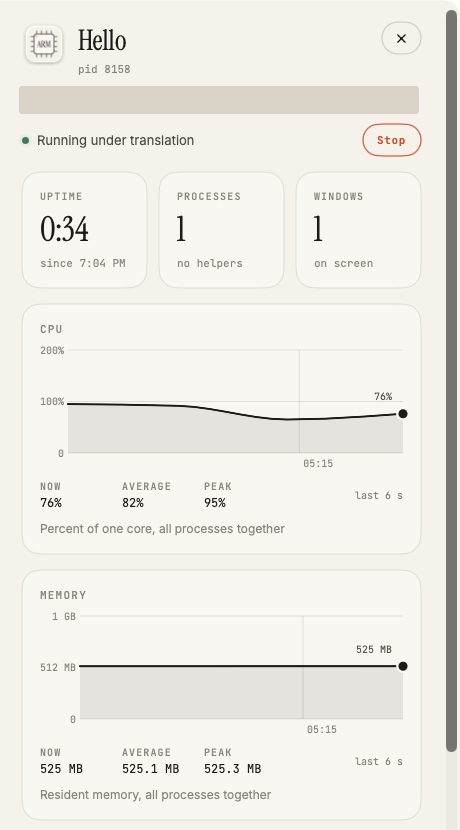

# Compatibility

What has been tried under Maclator, and how it went. The tables below record what was run, on which of two Intel
machines, and what was checked; a longer list generated from the launcher's own records is at the end.

## What "works" means

"Works" means the program starts and opens its window (or, for command-line tools, does its job); features beyond
that are noted where they were checked. Times are to the first window on a **first launch** with an empty
translation cache; later launches are faster (small AppKit/Swift apps take 8-40 s, Chromium and Electron apps up to
a few minutes). The machine-readable list is [compatibility.json](compatibility.json); the launcher app shows the
same data.

**Add your results.** Run apps from Maclator.app (it records each run on your Mac), then:

```bash
scripts/compat.py import && scripts/compat.py markdown
```

`import` merges your records into `docs/compatibility.json`; `markdown` rewrites only the generated region at the
end of this page.

## Test machines

Tested on two Intel machines:

- **A**: Core i5-4440 (4 cores) with an AMD Radeon RX 460, macOS 26.7 (upstream's test machine).
- **B**: an **HP EliteBook 840 G7 running macOS as a Hackintosh**: Core i5-10310U (4 cores / 8 threads, Comet Lake),
  16 GB, Intel UHD 620 (spoofed as `0x3E9B`), SMBIOS `MacBookPro16,2`, so About This Mac calls it a "MacBook Pro
  13-inch, 2020". macOS Tahoe 26.6 (25G72) boots with OpenCore 1.0.8; the OCLP-X post-install root patch restores
  Wi-Fi (Ventura `IO80211` stack) and audio, which breaks the system volume's seal. EFI, kexts and notes:
  [HP-Elitebook-840-G7-Tahoe-EFI](https://github.com/pointlessduffin-21/HP-Elitebook-840-G7-Tahoe-EFI).

## Screenshots


*Hello.app (in `examples/hello-arm`) under Maclator on an Intel Mac: the arm64 slice runs and reports what it sees.*



*The same app run directly, as x86-64 code, on the same Mac.*



*Maclator.app, Library: the arm64 apps found on the Mac's volumes, with the result of each recorded run. A folder path in one row is covered.*



*Maclator.app, Running: the inspector for a program running under translation, with live CPU and memory. The program's path is covered.*


*The arm64-only ChatGPT app running under Maclator on machine B, an HP EliteBook 840 G7 Hackintosh (i5-10310U, Intel UHD 620, macOS 26.6; About This Mac shows its `MacBookPro16,2` SMBIOS), with the launcher showing the run. Serial number redacted.*


*The arm64 Chromium 157 snapshot running under Maclator on an Intel Mac (`chrome://gpu`): compositing, rasterization, WebGL and WebGPU are hardware accelerated on the machine's AMD Radeon RX 460, through the ANGLE/Metal bridge.*

## Results by program

### arm64-only programs (there is no Intel build)

| Program | Kind | Mac | Result | Conditions |
|---|---|---|---|---|
| ChatGPT desktop 26.928 (`com.openai.codex`) | Chromium 154 | B | works (2 min) | `--no-sandbox` [C]; host icon service healthy [H] |
| VS Code 1.139 (darwin-arm64) | Electron | A | works; typing latency ~40 ms | `--no-sandbox` [C]; `scripts/vscode-gpu` for GPU |
| Chromium 157 snapshot | Chromium | A | works, **GPU accelerated** (ANGLE/Metal → RX 460, 60 fps canvas) | `--no-sandbox` [C]; `--gpu --gpu-only --type=gpu-process` ([GPU](GPU.md)) |
| Pixelmator Pro 4.0 (`com.apple.pixelmator`) | Swift | B | partial: opens a window (44 s), then quits with an error | cause not investigated |
| balenaEtcher 2.1.7 | Electron | A | starts; device access untested | `--no-sandbox` [C] |
| Homebrew 7.0.7 (Apple Silicon only since macOS 26) | bash + Ruby 4.0.7 | B | works: official installer, `brew install`, arm64 bottles | `--arm64-children`; see [Homebrew](USAGE.md#homebrew) |
| Homebrew bottles: `hello`, `fastfetch`, `yyjson` | C | B | work | through `~/bin/brew` and its shims |
| `fastfetch`, `neatvi` | C | A | work | none |
| AppKit calculator (`tests/guest/calc`) | AppKit | A | works | none |

### Universal apps (their arm64 half, run under Maclator)

| Program | Kind | Mac | Result | Conditions |
|---|---|---|---|---|
| Microsoft Word, Excel, PowerPoint 16.113 | AppKit, sandboxed | B | work (15–26 s); documents not checked | [S] |
| Microsoft OneNote 16.113 | AppKit + JavaScriptCore, sandboxed | B | works (19 s) | [S]; thread suspension [T] |
| Pages, Numbers, Keynote 15.3 | Swift, sandboxed, App Store | B | work (15–20 s); iCloud not checked; busy CPU while idle | [S]; own entitlements [E] |
| Final Cut Pro 12.3 | Swift, sandboxed, App Store | B | works (87 s); editing not checked | [S]; [H] |
| Pixelmator Pro 3.6 | Swift, sandboxed, App Store | B | works; relaunches itself at start | [S] |
| Windows App 11.4 | Swift, sandboxed, App Store | B | works (11 s); remote sessions not checked | [S] |
| Google Chrome 154 | Chromium | B | works (29 s) | `--no-sandbox` [C] |
| Termius 10.1 | Electron | B | works (2.5 min) | `--no-sandbox` [C] |
| HandBrake 1.11 | AppKit, sandboxed | B | works (36 s); encoding not checked | [S] |
| Hidden Bar 1.8 | Swift, sandboxed, App Store | B | works (8 s) | [S] |
| AppCleaner 3.6.8 | AppKit | B | works (40 s) | none |
| foobar2000 2.25 | C++/AppKit | B | works (15 s) | none |
| VLC 3.0.24 | AppKit | B | works (10 s); playback not checked (no audio yet) | none |
| coconutBattery 4.4 | Swift | B | works (26 s); readings not checked | none |
| FluxMarkdown 1.34 | Swift | B | works (8 s) | none |
| Mos 4.2 | Swift | B | works (12 s); scroll smoothing not checked | needs Accessibility permission for its feature |
| RDM 2.5, OneDrive | menu bar | B | start and keep running; menus not checked | none |
| Ghostty 1.3.1 | Swift + Zig, Metal | B | opens a window; whether the terminal draws is unconfirmed | `CAMetalLayer` is not bridged yet; CPU feature report [F] |

**Conditions**

- **[C] Chromium/Electron**: run with `--no-sandbox` (the Chromium sandbox cannot initialise under Maclator). The
  launcher app adds it for any Chromium-based app; from a terminal, pass it after the program path.
- **[S] Sandboxed apps** start *without* their sandbox: the host only knows `maclator`'s signature. They run, but
  keep their data in your home folder rather than in a container.
- **[E] Own entitlements**: frameworks such as CloudKit check the process's entitlements and trap without them;
  Maclator answers the guest's own `csops` queries from the app's signature (`codesign.rs`).
- **[T] Thread suspension**: JavaScriptCore's garbage collector (and anything with a web view) suspends threads and
  reads their registers; Maclator emulates this cooperatively (`suspend.rs`).
- **[F] CPU features**: guests are told about AES/PMULL/SHA1/SHA256, which Maclator implements and software built
  for Apple Silicon may require.
- **[H] Host health**: apps wait for the icon service (`iconservicesagent`) at start. On machine B, the OCLP-X root
  patch left the system volume with a broken seal, and *native* x86 processes using VideoToolbox (icon service,
  Safari, `mediaanalysisd`) crash with `FS pagein error: 94 Bad message`; while that happens, apps under Maclator
  hang before their first window. A restart (and if needed re-applying the root patches) clears it.

Not done: audio, most IOKit hardware, `CAMetalLayer`-based apps (the GPU bridge covers Metal used by Chromium/ANGLE,
not apps that present through a Metal layer directly), FairPlay-encrypted iOS apps.

## Full list

Every app in [compatibility.json](compatibility.json).

<!-- compat:start -->
Generated from [compatibility.json](compatibility.json) by `scripts/compat.py markdown`; the launcher app reads the same file. Times are to the first window on a first launch with an empty translation cache.

Recorded on: HP EliteBook 840 G7 Hackintosh: Intel Core i5-10310U (4 cores / 8 threads), 16 GB, Intel UHD 620, macOS Tahoe 26.6 (OpenCore 1.0.8, OCLP-X root patch).

- **Works**: the app starts and opens its window; anything beyond that is in the notes.
- **Partly works**: it starts, but something breaks or is missing (see the notes).
- **Doesn't run**: it never reaches a usable window.
- **Not tried**: no result recorded.

### Works (21)

| App | Bundle ID | First window | Tested | Notes |
|---|---|---|---|---|
| AppCleaner | `net.freemacsoft.AppCleaner` | 40 s | 2026-10-02 | Objective-C/AppKit. Window after about 40 s on the first launch. |
| ChatGPT | `com.openai.codex` | 102 s | 2026-10-11 | Chromium-based, arm64 only (no Intel version). Needs --no-sandbox; window after about 2 minutes on the first launch. |
| coconutBattery | `com.coconut-flavour.coconutBattery` | 26 s | 2026-10-02 | Swift/AppKit. Battery readings not checked. |
| Final Cut Pro | `com.apple.FinalCutApp` | 87 s | 2026-10-02 | Sandboxed. Editing and rendering not checked. |
| FluxMarkdown | `com.xykong.Markdown` | 8 s | 2026-10-02 | Swift. |
| foobar2000 | `com.foobar2000.mac` | 15 s | 2026-10-02 | C++/AppKit. |
| Google Chrome | `com.google.Chrome` | 29 s | 2026-10-02 | Chromium 154. Needs --no-sandbox. |
| HandBrake | `fr.handbrake.HandBrake` | 36 s | 2026-10-02 | Sandboxed, but starts. Encoding not checked. |
| Hidden Bar | `com.dwarvesv.minimalbar` | 8 s | 2026-10-02 | Swift, sandboxed, from the App Store. |
| Keynote | `com.apple.Keynote` | 20 s | 2026-10-02 | As Pages. |
| Microsoft Excel | `com.microsoft.Excel` | 15 s | 2026-10-02 | Sandboxed. |
| Microsoft OneNote | `com.microsoft.onenote.mac` | 19 s | 2026-10-02 | Needed thread_suspend/get_state for JavaScriptCore's GC (now emulated). |
| Microsoft PowerPoint | `com.microsoft.Powerpoint` | 21 s | 2026-10-02 | Sandboxed. |
| Microsoft Word | `com.microsoft.Word` | 26 s | 2026-10-02 | Sandboxed. Documents not checked. |
| Mos | `com.caldis.Mos` | 12 s | 2026-10-02 | Swift. Scroll smoothing itself not checked (needs the Accessibility permission). |
| Numbers | `com.apple.Numbers` | 16 s | 2026-10-02 | As Pages. |
| Pages | `com.apple.Pages` | 15 s | 2026-10-02 | Needed the guest's own entitlements (CloudKit traps without them). High CPU at idle; iCloud not checked. |
| Pixelmator Pro | `com.pixelmatorteam.pixelmator.x` |  | 2026-10-02 | Relaunches itself on start; the second copy opens the window. |
| Termius | `com.termius-dmg.mac` | 145 s | 2026-10-02 | Electron. Window after about 2.5 minutes on the first launch. |
| VLC | `org.videolan.vlc` | 10 s | 2026-10-02 | Playback not checked. |
| Windows App | `com.microsoft.rdc.macos` | 11 s | 2026-10-02 | Sandboxed. Remote sessions not checked. |

### Partly works (4)

| App | Bundle ID | First window | Tested | Notes |
|---|---|---|---|---|
| Ghostty | `com.mitchellh.ghostty` | 8 s | 2026-10-02 | Opens a window and runs its event loop; whether the terminal draws is unconfirmed (it renders through CAMetalLayer, which the GPU bridge doesn't cover yet). |
| OneDrive | `com.microsoft.OneDrive` |  | 2026-10-02 | Menu-bar app: starts and keeps running; no window to check. |
| Pixelmator Pro Creator Studio | `com.apple.pixelmator` | 44 s | 2026-10-11 | Opened a window, then quit with an error. |
| RDM | `net.alkalay.RDM` |  | 2026-10-02 | Menu-bar app: starts and stays running; the menu itself not checked yet. |
<!-- compat:end -->
